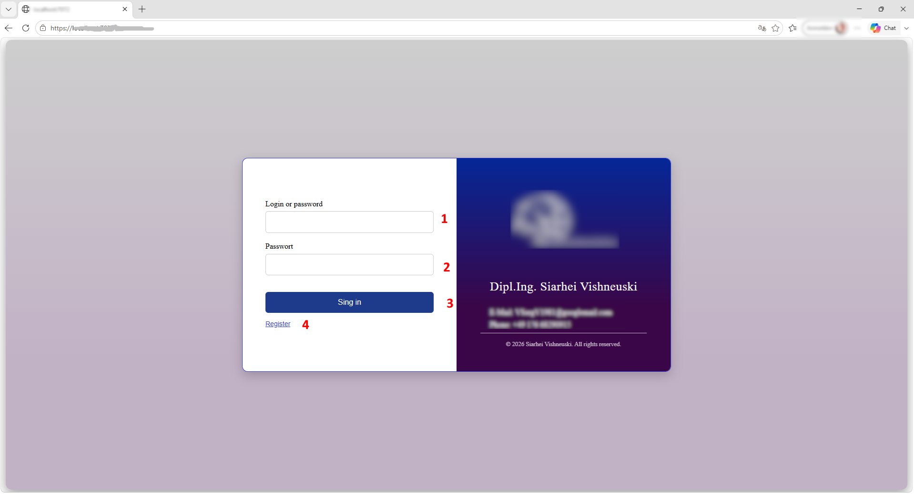
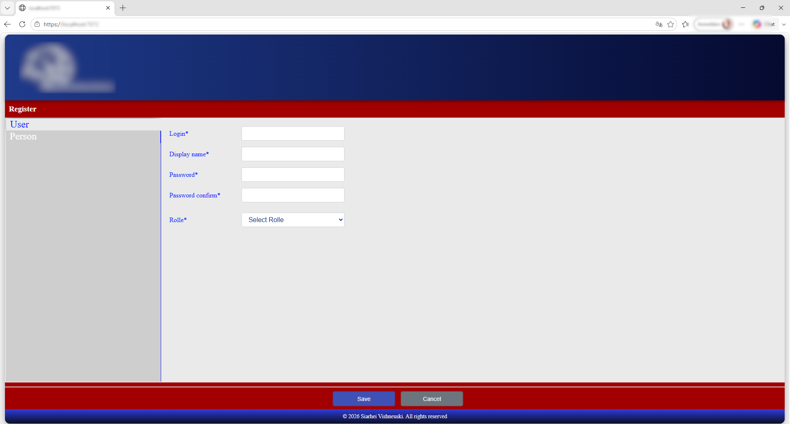
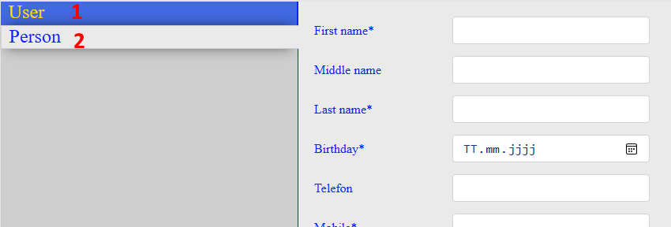
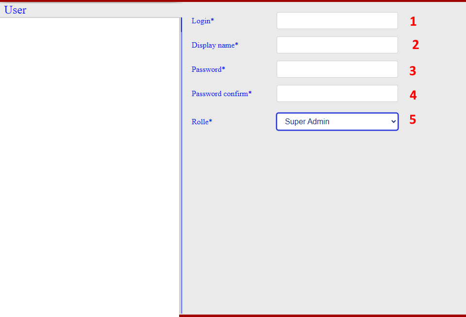
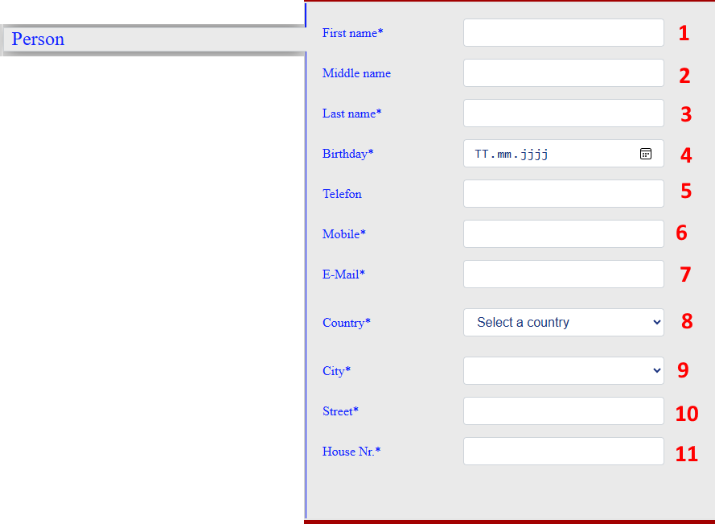
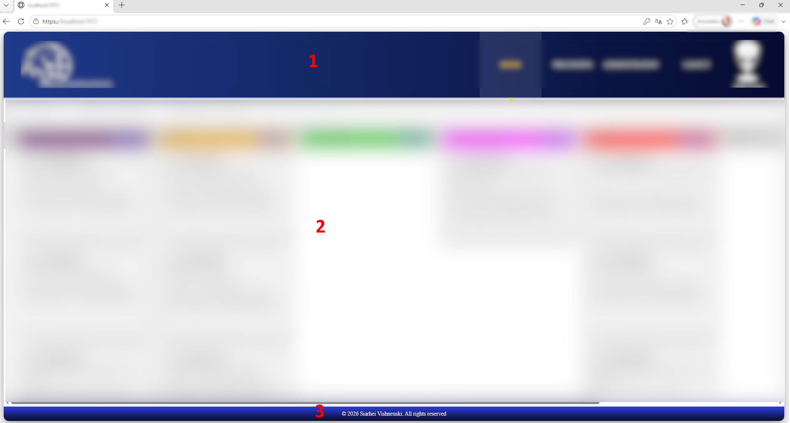
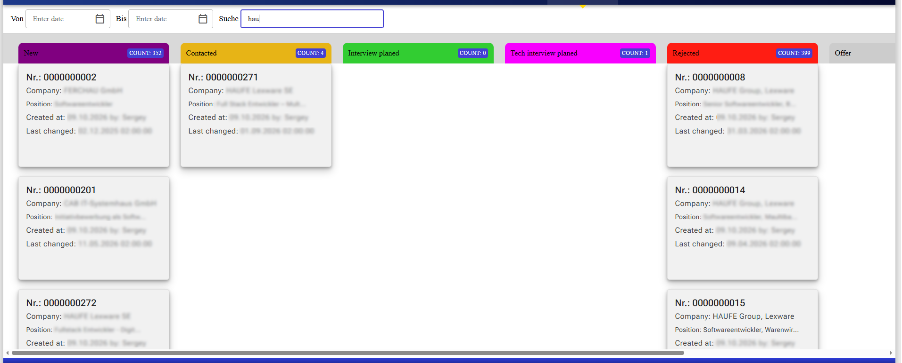
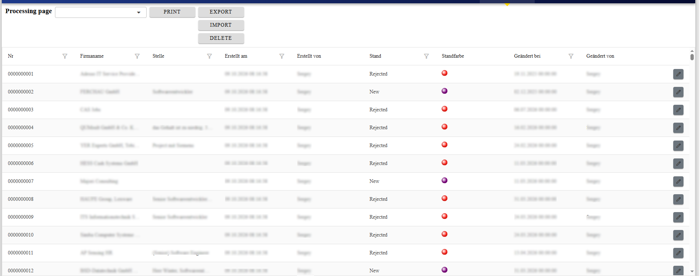
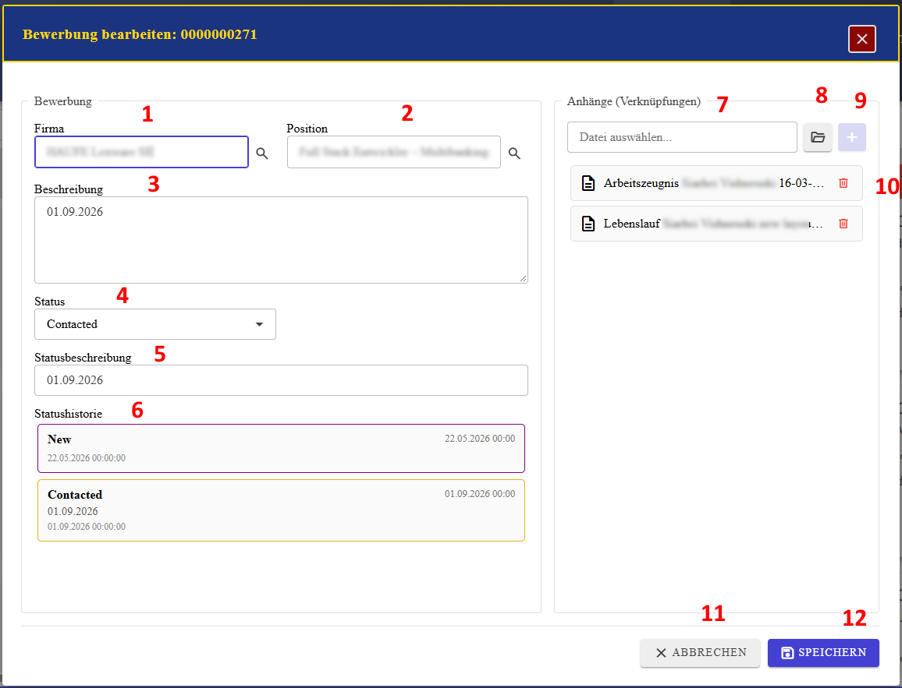
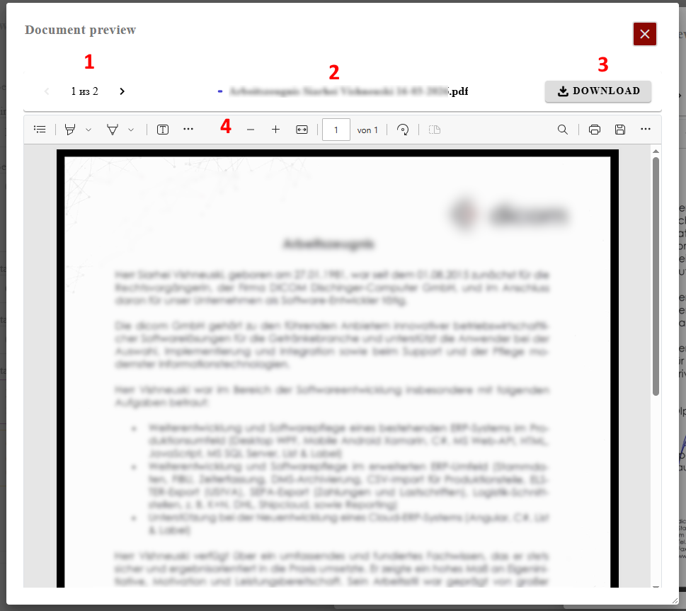

  
  
  
  
  
  
  
  

Self-contained .NET 9 Windows x64 build.
Published application with obfuscated assemblies.
Obfuscar version: 2.2.50.
Application version: 26.10.0111.
# Application Assistant — User Guide

Application Assistant helps organize job applications, track their status, store related documents, and generate PDF documents. Applications can be viewed on a Kanban board or in a table. The application was built with Blazor Server and Clean Architecture for learning purposes and uses SQLite as its database. The expected maximum volume is approximately 10,000 applications.

## Contents

- [1. Sign in and register](#1-sign-in-and-register)
- [2. Registration form](#2-registration-form)
- [3. Main workspace and navigation](#3-main-workspace-and-navigation)
- [4. Home: Kanban board](#4-home-kanban-board)
- [5. Processing: application table](#5-processing-application-table)
- [6. View and edit an application](#6-view-and-edit-an-application)
- [7. Reports and print templates](#7-reports-and-print-templates)
- [8. Document preview](#8-document-preview)

## 1. Sign in and register

When you open the application in a browser, the sign-in page is displayed. Enter your username and password, then select the sign-in button.

If you do not have an account, select **Register** below the sign-in button to open the registration page.

## 2. Registration form

The registration form has two sections, accessible through the **User** and **Person** tabs. Use **Save** to save the form or **Cancel** to discard changes.

### User details

Complete the following fields:

1. **Login*** — unique username used to sign in.
2. **Display name*** — name displayed in the application interface.
3. **Password*** — password for the account.
4. **Password confirm*** — re-enter the password.
5. **Role*** — select the system role, for example, *Super Admin*. The role determines access rights.

An asterisk (*) indicates a required field.

### Personal details

Switch to the **Person** tab and enter the user's personal and contact information:

1. **First name*** — first name.
2. **Middle name** — middle name; optional.
3. **Last name*** — last name.
4. **Birthday*** — date of birth; enter it manually or use the calendar.
5. **Telefon** — landline or work telephone number.
6. **Mobile*** — mobile phone number.
7. **E-Mail*** — email address.
8. **Country*** — country of residence.
9. **City*** — city of residence.
10. **Street*** — street name.
11. **House Nr.*** — house number.

Fields marked with an asterisk are required.

## 3. Main workspace and navigation

After signing in, the main workspace is displayed. It consists of three areas:

1. **Top navigation bar** — application logo, navigation links and the signed-in user's profile.
2. **Main work area** — displays and allows users to edit application data.
3. **Footer** — developer information and copyright notice.

The navigation bar contains:

- **HOME** — opens the main workspace with applications arranged by status; applications can be edited here.
- **PROCESSING** — opens the application list and provides tools to create, process, and track applications, print PDFs, and import, export, or edit print templates.
- **ADMINISTRATION** — administration settings, including status-card colors and data import. Available only to users with the **Admin** or **Super Admin** role.
- **LOGOUT** — signs out of the current account.
- **User profile** — displays the user's avatar and greeting.

## 4. Home: Kanban board

The Home page displays a Kanban board with colored columns representing application statuses. This makes it easier to track the processing stage of each application.

- **Filter panel** — the **From / To** fields specify a date range; **Search** searches by keywords in real time.
- **Status columns** — examples include *New*, *Contacted*, *Interview planned*, *Tech interview planned*, *Rejected*, and *Offer*. Each column header shows the number of applications (**COUNT**) in that status.
- **Application cards** — display the application number (**Nr.**), company, position, creation date and author (**Created at**), and last modification date (**Last changed**).

## 5. Processing: application table

The **Processing** page presents registered applications in an interactive table for reviewing, editing, and adding records.

### Toolbar

- **View/mode selector** — switches between available data views or processing modes.
- **Template selector** — selects a print template.
- **PRINT** — opens document generation and printing options for selected records.
- **EXPORT** — exports the current application list to a file; PDF is given as an example in the original guide.
- **IMPORT** — imports prepared data and documents in bulk.
- **DELETE** — permanently deletes the selected rows.

### Table columns

- **Nr.** — unique ten-digit application number; supports filtering.
- **Firmenname** — employer or company name; supports filtering.
- **Stelle** — vacancy or position; supports filtering.
- **Erstellt am** — date and time the application was created.
- **Erstellt von** — user who created the record.
- **Stand** — current processing status, such as *New* or *Rejected*; supports filtering by status.
- **Standfarbe** — color indicator for the card's status.
- **Geändert bei** — date and time of the last modification.
- **Geändert von** — user who last edited the record.

### Editing a record

Select the pencil icon at the far right of a row. The data is transferred to an editing row. Select that empty row and press **F2** to open the detailed view and editing dialog. There you can update personal or system data, change the application's status, add comments about the status, and attach PDF, DOC, or DOCX files. If the detailed dialog has not been opened, press **Escape (Esc)** to cancel row editing.

## 6. View and edit an application

The detailed dialog opens from the pencil icon in the table or on the Kanban board. It lets you review and edit an application and manage its attachments. The dialog has three main areas: application information on the left, attachments on the right, and action buttons at the bottom.

### Application section (Bewerbung)

1. **Firma** — view or select the employer; the magnifying-glass button opens the company lookup.
2. **Position** — view or select the vacancy; includes a lookup button.
3. **Beschreibung** — multiline description, notes, or vacancy requirements, with a date.
4. **Status** — select the current processing status.
5. **Statusbeschreibung** — enter a comment about the status change.
6. **Statushistorie** — chronological history of previous and current statuses with their dates and times.

### Attachments section (Anhänge / Verknüpfungen)

7. **Datei auswählen…** — choose a local file to upload.
8. **Browse button** — opens the operating system's file-selection dialog.
9. **+ button** — adds the selected file to the application's attachment list.
10. **File list** — shows attached files, such as a CV (*Lebenslauf*) or employment reference (*Arbeitszeugnis*). Double-click a filename to open it in the preview dialog and/or download it. Use the trash icon to remove a file from the application.

### Action buttons

- **ABBRECHEN** — closes the dialog without saving changes.
- **SPEICHERN** — saves the application's changes and updated attachment list to the database, then closes the dialog.

## 7. Reports and print templates

The application uses **FastReport OpenSource**, so print templates cannot be edited directly inside the web application. Instead, export a template, edit it externally, and import it back.

### Export a template

1. Enter or select the template name in the template selector above the table.
2. Select **EXPORT**.
3. If a template with that name does not exist in the database, the system creates it automatically and exports it to your computer's **Downloads** folder.
4. If the template already exists, the currently saved version is exported.

### Import a template

1. Select **IMPORT** on the toolbar.
2. In the file-selection dialog, choose a template file with the **.frx** extension.
3. If a name was entered in the template selector before import, the template is saved under that name. If the field is empty, the original filename (without the extension) is used.
4. If a template with that name already exists in the database, the application asks you to confirm overwriting it.

### Generate a report

The application does not print directly to a physical printer. Instead, it generates a PDF file.

1. Select the required record.
2. Select **PRINT**.
3. The generated PDF is automatically saved to the computer's **Downloads** folder, where it can be viewed or printed.

## 8. Document preview

Double-click a file in the attachments list to open the preview dialog. It allows PDF documents to be viewed inside the application without opening a separate program.

The dialog contains:

1. **File navigation** — shows the current file number and total number of files (for example, 1 of 2). The left and right arrow buttons move between attached files without closing the dialog.
2. **Filename** — shows the full name of the currently open file, including its extension.
3. **DOWNLOAD** — saves the currently viewed file to the local computer.
4. **PDF viewer toolbar** — provides page navigation, zoom in/out, page rotation, fit-to-width, printing, and saving through the viewer's standard controls.

Use the **X** button in the upper-right corner to close the preview and return to the previous form.

---

*This English guide is based on the supplied Russian-language user manual. Interface labels are retained as they appear in the application where useful.*
