

  
  
  
  
  
  
  
  

Self-contained .NET 9 Windows x64 build.
Published application with obfuscated assemblies.
Obfuscar version: 2.2.50.
Application version: 26.11.0023.
# Application Assistant — User Manual

## Introduction

The **Application Assistant** application was designed to organize job applications and monitor their status in real time. It allows users to document and archive job requirements, centrally store, view, and download related files. Information is presented in a user-friendly format: Kanban boards with filtering or a traditional table view. The application also supports configuring document forms and saving text data as PDF.

The application is built with **Blazor Server** and follows the **Clean Architecture** approach. It was created for educational purposes and hands-on practice with this technology stack.

SQLite was selected as the data store because the expected volume of data is relatively small. The anticipated maximum is approximately 10,000 applications.

## User menu and interface

### Login page

When the application is opened in a browser, the login page appears (Figure 1). Users sign in by entering their username (field 1) and password (field 2), then clicking **Sign In** (button 3).

To sign in:
1. Enter your credentials in fields 1 and 2.
2. Click the Sign In button (3).

To register, click **Register** (link 4), located below the Sign In button, to open the registration form.

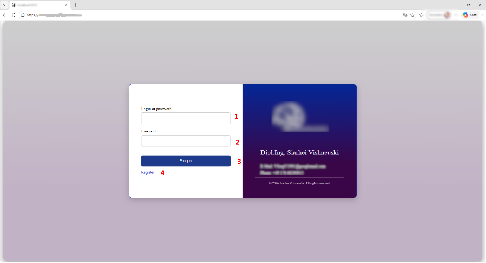
*Figure 1. Login page overview*

Clicking Register opens the account creation page (Figure 2).

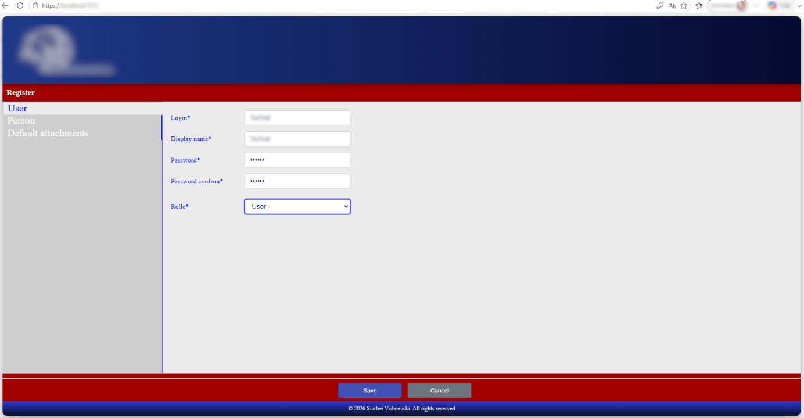
*Figure 2. Registration page overview*

### Registration form

The registration form is divided into two main parts:

1. **User details** — central fields for account setup: Login, Display name, Password, Password confirm, and Role.
2. **Personal details** — the left-side menu with tabs **User / Person / Default attachments**, for entering personal information and documents commonly used with applications.

Use **Save** to complete the process or **Cancel** to discard changes. Switch between the sections using the **User** (1), **Person** (2), and **Default attachments** (3) tabs (Figure 3).

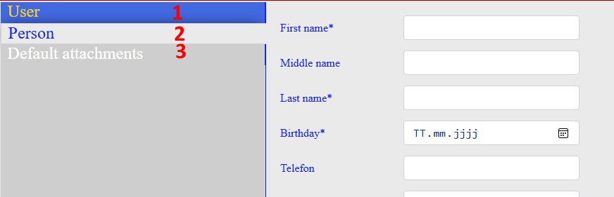
*Figure 3. Registration form tabs*

#### User tab

The User section contains:
1. **Login*** (field 1) — unique username used to sign in.
2. **Display name*** (field 2) — name shown in the application interface.
3. **Password*** (field 3) — account password.
4. **Password confirm*** (field 4) — re-enter the password to confirm it.
5. **Role*** (dropdown 5) — select a system role (for example, Super Admin), which determines access permissions.

An asterisk (*) indicates a required field.

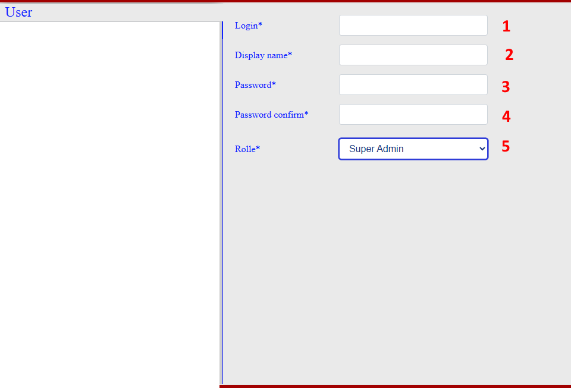
*Figure 4. User section of the registration form*

#### Person tab

The Person tab contains personal and contact details (Figure 5):
1. **First name*** (field 1) — first name.
2. **Middle name** (field 2) — middle name; optional.
3. **Last name*** (field 3) — surname.
4. **Birthday*** (date field 4) — date of birth; enter manually or use the calendar.
5. **Telefon** (field 5) — landline/home or work telephone number.
6. **Mobile*** (field 6) — mobile phone number.
7. **E-Mail*** (field 7) — email address.
8. **Country*** (dropdown 8) — country of residence.
9. **City*** (dropdown 9) — city of residence.
10. **Street*** (field 10) — street name.
11. **House Nr.*** (field 11) — house number.

Fields marked with an asterisk are required.

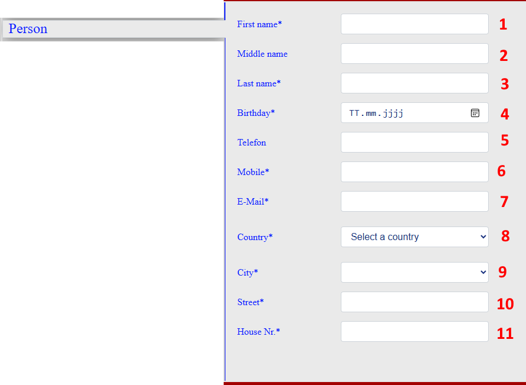
*Figure 5. Person tab*

#### Default attachments tab

The **Default attachments** tab (Figure 6) lets you upload documents that will be reused when creating applications. Its controls are:

1. **Default attachments** — container listing documents saved as defaults.
2. **Filename display field** — shows the selected file name.
3. **File selection button** — opens a file picker; the selected file name appears in field 2.
4. **Add file button** — adds the selected file to the default documents list (item 6).
5. **Delete file button** — removes a file from the default list. First, double-click the file name in list 6 with the left mouse button; its name will appear in field 2. Then click button 5 to remove it.
6. **Default documents list** — files stored for later use when working with applications.

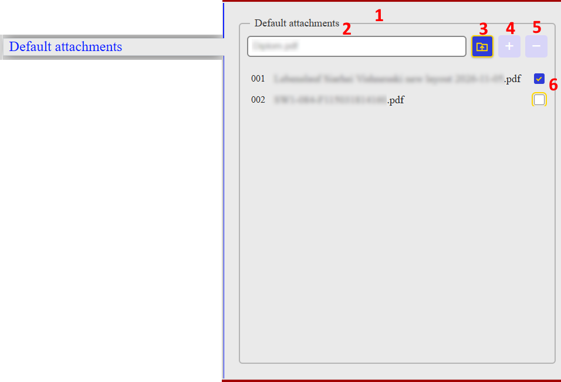
*Figure 6. Default attachments tab*

**Note:** Each file in list 6 has a checkbox. When checked, the file is automatically copied from the default attachments list into the application's attachments list when a new application is created or an existing one is opened for editing. If unchecked, it will not be added automatically.

Personal data can also be edited via **Administration → Private data edit**.

## Main workspace

After a successful login, the user enters the main workspace. The home screen is divided into three areas (Figure 7):

1. **Top navigation bar** (area 1) — application logo, navigation menu for switching modules (such as application lists and settings), language switcher, and the signed-in user's profile.
2. **Main work area** (area 2) — central area where data is displayed and edited.
3. **Bottom bar / Footer** (area 3) — developer information and copyright notice.

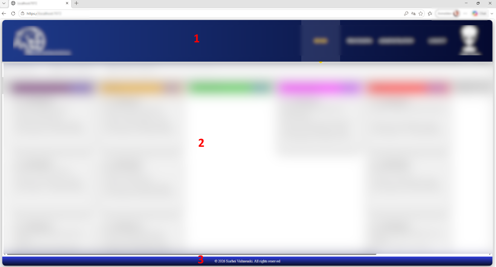
*Figure 7. Main workspace*

### Top navigation bar

The navigation bar provides access to application sections and general information. The developer's logo is on the left; navigation and user controls are on the right (Figure 8):

1. **HOME** (1) — returns to the main workspace, where current applications are shown in columns by status; applications can also be edited here.
2. **PROCESSING** (2) — section for creating, processing, and tracking applications; printing to PDF; and importing, exporting, and editing print forms.
3. **ADMINISTRATION** (3) — administration panel for system settings (for example, card-status colors) and data import. Available only to users with the **Admin** or **Super Admin** role.
4. **LOGOUT** (4) — securely signs out of the current account.
5. **Profile** (5) — shows the signed-in user's avatar and greeting (for example, “Hallo, User”).

*Figure 8. Top navigation bar*

### Main work area

The main area displays pages for viewing and managing data. Selecting **Home** opens a Kanban board with colored columns for tracking application statuses. Selecting **Processing** opens the registered applications in a conventional table (Figure 9 and Figure 10).

#### Home page: Kanban board

The Kanban board uses colored columns to visualize the status and processing stage of each application (Figure 9).

Screen controls and structure:
- **Filter panel** (top): date range fields (**From / To**) and a **Suche** search field for real-time keyword filtering.
- **Kanban columns / workflow stages**: each column corresponds to a status, such as New, Contacted, Interview planned, Tech interview planned, Rejected, or Offer. The header shows the number of applications in the column (**COUNT**).
- **Application cards**: each card displays key information:
  - Application number (**Nr.**)
  - Company
  - Position
  - Creation date and author (**Created at**)
  - Last modified date (**Last changed**)

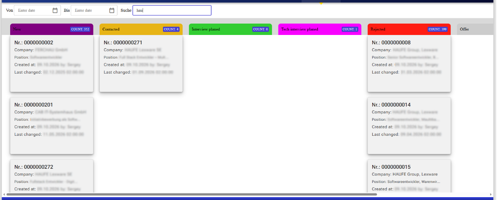
*Figure 9. Home page — Kanban board*

#### Processing page: application management table

The **Processing** page is an interactive table for viewing the application database, changing current data, and adding new applications.

**Toolbar (top):**
- **View/mode dropdown** (left) — switches between available data views or processing modes.
- **Form selection dropdown** — selects the form/template.
- **PRINT** — opens document generation and printing options for selected records.
- **EXPORT** — exports the current application list to an external file (for example, PDF).
- **IMPORT** — bulk-imports prepared data and documents.
- **DELETE** — permanently deletes selected rows from the database.

**Table columns:** Each row represents an application and contains:
- **Nr.** — unique ten-digit application number; filterable.
- **Firmenname** — employer/company name; filterable.
- **Stelle** — job title/position applied for; filterable.
- **Erstellt am** — exact date and time the application was registered.
- **Erstellt von** — user who created the record.
- **Stand** — current processing status (such as New or Rejected); filterable.
- **Standfarbe** — color indicator representing the card's status.
- **Geändert bei** — date and time of the most recent change.
- **Geändert von** — user who last edited the record.

**Editing records:** The far-right column contains a pencil icon for each row. Clicking it transfers the record into an edit row, which appears blank. Select this blank row and press **F2** to open the detailed editing and viewing window. There you can manually update any personal or system data (including status), add comments about the current status, and attach PDF, DOC, or DOCX files. If the edit window has not been opened, editing can be cancelled with **Escape (Esc)**.

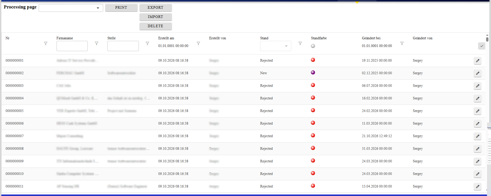
*Figure 10. Application management table*

## Reports and printable forms

The application uses **FastReport OpenSource**. Editing report templates directly inside the web application is not supported. To change a template, export it together with its data structure, edit it externally, and import it back.

### 1. Export a form/template

Click **EXPORT** in the toolbar above the table.
- Before exporting, enter or select the template name in the relevant dropdown field.
- If no template with that name exists in the database, the system creates it and exports it to your computer's **Downloads** folder.
- If the template already exists, the currently saved version is exported.

### 2. Import a form/template

Use **IMPORT** in the toolbar to upload an edited template.
- A standard operating-system file picker opens. Select a template file with the **.frx** extension.
- **Naming:** If a name is entered in the dropdown before importing, the template is saved under that name. If the field is blank, the file's original name (without extension) is used.
- **Duplicate check:** Before saving, the application checks whether a template with that name already exists. If it does, a confirmation prompt asks whether to overwrite it.

### 3. Print reports

The application does not print directly to a physical printer. It uses virtual printing to generate a PDF.
1. Select the required record and click **PRINT**.
2. The PDF, ready for viewing or printing, is automatically saved to the **Downloads** folder.

## Application details and editing window

The details modal opens when the pencil edit icon is clicked in the table or on the Kanban board. It allows you to inspect and edit an application and manage its attached files.

The window has three main areas: application information on the left, attachment management on the right, and action buttons along the bottom.

### “Bewerbung” section — application information
1. **Firma** (1) — employer/company selector, with a magnifying-glass button to choose a company from the directory.
2. **Position** (2) — job-position selector, also with a search button.
3. **Beschreibung** (3) — multiline field for detailed description, notes, or job requirements, with date tracking.
4. **Status** (4) — dropdown for changing the current application status (for example, Contacted or Interview planned).
5. **Statusbeschreibung** (5) — text field for a comment on the status change.
6. **Statushistorie** (6) — chronological history of previous and current statuses, with exact timestamps.

### “Anhänge (Verknüpfungen)” section — attachments
7. **Default attachments** (7) — selection area for files stored locally or available for upload.
8. **APPLY** (8) — copies selected default files from area 7 into the attachment list (12); select files using their checkboxes.
9. **Datei auswählen...** (9) — file selection field for a local document to upload.
10. **Browse button** (10) — opens the operating-system file dialog.
11. **“+” button** (11) — confirms and uploads the selected file into the application's attachments list.
12. **File list** (12) — currently attached documents (for example, Lebenslauf/CV or Arbeitszeugnis/reference). Double-click a file name to open it in the preview and/or download it from there. The trash icon next to a file removes it from the application.

**Bottom action bar:**
13. **ABBRECHEN** (13) — cancels and closes the window without saving changes.
14. **SPEICHERN** (14) — saves application changes and the updated file list to the database, then closes the window.

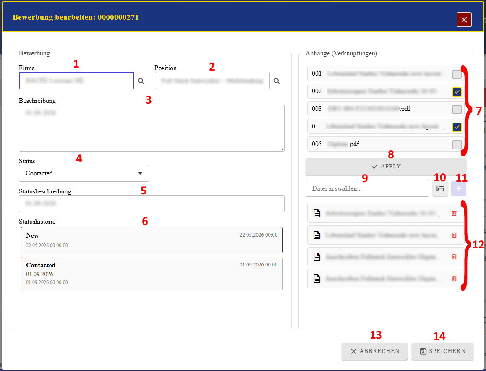
*Figure 11. Application details and editing window*

## Document preview window

Double-click a file in the attachments list to open the preview dialog. It displays PDF content inside the application without requiring an external program.

The dialog includes:
1. **File navigation panel** (1) — current document number and total number of files (for example, 1 of 2); left/right arrows switch between attached files without closing the preview.
2. **Filename** (2) — full name and extension of the open document (for example, .pdf, .doc, or .docx).
3. **DOWNLOAD** (3) — saves the currently previewed file to the user's computer.
4. **PDF viewer toolbar** (4), including:
   - Page navigation (for example, 1 of 1)
   - Zoom in/out (+ / −)
   - Page rotation and fit-to-width options
   - Quick print and local-save functions through the viewer

Click the X in the top-right corner to close the preview and return to the previous form.

*Figure 12. Document preview window*

## Editing the application status color palette

The **State Editor** in Administration configures the colors used to represent application statuses (Figure 13). The interface lists the statuses and provides a color selector beside each one. Colors help distinguish applications by their current status.

Available statuses: **New, Contacted, Interview planed, Tech interview planed, Rejected, Offer,** and **Storno**.
- **Color selectors** — choose a color for each status. Clicking a selector opens the available color palette.
- **SAVE** — saves palette changes.
- **RESET** — resets the palette settings.

To change a status color, select its color control, choose the desired color, and click **SAVE**.
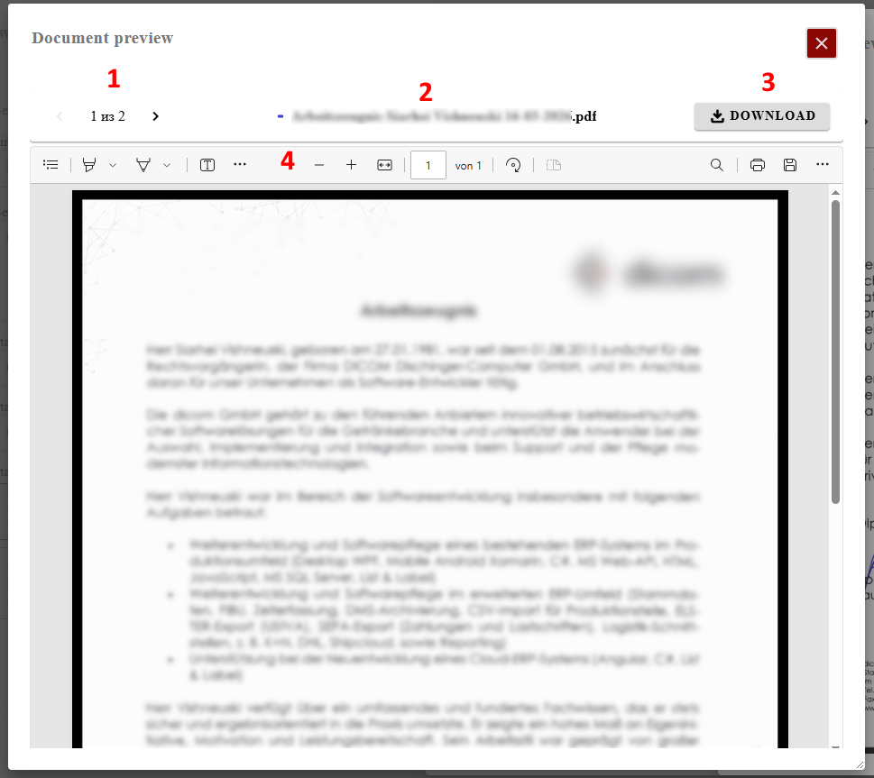
*Figure 13. Status color palette editor*

## Conclusion and technical support

This manual is intended to make working with Application Assistant efficient, clear, and convenient. The Clean Architecture approach and Blazor Server technology provide responsive data handling and system stability in real time.

### Feedback and troubleshooting
If you encounter technical problems, have questions about filling out forms, or have suggestions for improving the interface, contact the system administrator or support:
- **Email:** VSergV1981@googlemail.com
- **Project repository / issue reporting:** GitHub or GitLab link (the source document mentions this as an option for an educational or portfolio project; no specific repository URL is provided).

### Quick keyboard reference
- **F2** — opens the detailed editing and viewing window for the selected row.
- **Escape (Esc)** — cancels row editing / closes the current form.

### Glossary
- **Authentication (sign-in):** checking a user's access to the application after they enter their username and password.
- **Database:** an organized structure for centrally storing, modifying, and archiving application, user, and system-setting information.
- **Dropdown list:** interface control that lets the user select one or more predefined values (for example, a role or country).
- **Application:** the main record containing information about a job vacancy, employer, and candidate-related attachments.
- **Data import:** bulk loading information or document templates from local external files into the application's database.
- **Kanban board:** workflow visualization where application cards are arranged in colored columns, each representing a processing stage or status.
- **Modal (dialog) window:** interface window that temporarily blocks the main screen until the user completes an action such as saving, cancelling, or viewing.
- **Printable form (.frx template):** FastReport template file containing a fixed data structure and document layout rules for output/printing.
- **System role:** predefined account permissions (such as Admin or Super Admin) that determine which modules are available.
- **Application status:** the current processing stage of an application (for example, New, Interview planned, or Rejected), determining its position on the Kanban board.
- **Data export (virtual printing):** exporting application data to an external file (for example, PDF) for local storage or later printing.

---

*This English guide is based on the supplied Russian-language user manual. Interface labels are retained as they appear in the application where useful.*
